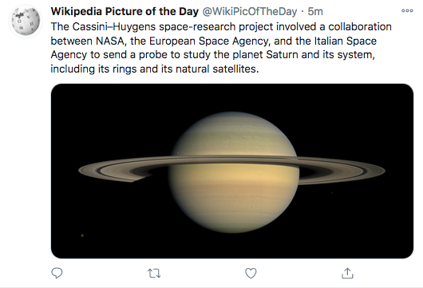

# Wikipedia Picture of the Day [](https://codecov.io/gh/ndrezn/wikipedia-pic-of-the-day) [](https://bsky.app/profile/wiki-potd.bsky.social) [](https://bsky.app/profile/potd-context.bsky.social)


<p align="center">
    
</p>


Posts the picture of the day from Wikipedia daily to Bluesky from [@wiki-potd.bsky.social](https://bsky.app/profile/wiki-potd.bsky.social). Based on the community sourced [Wikipedia Picture of the Day](https://en.m.wikipedia.org/wiki/Wikipedia:Picture_of_the_day).

Also powers a sibling account [@potd-context.bsky.social](https://bsky.app/profile/potd-context.bsky.social), which posts article titles, links, and extra captioning.

## Usage
Note that correct API keys are required as environment variables.

**To run**
```
# CONFIGURE ENVIRONMENT VARIABLES
uv sync
uv run bash run.sh
```
